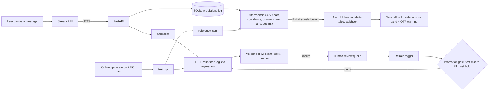

# Vortex OTP Classifier

> First-time mobile-banking users and pensioners in Sri Lanka are tricked by SMS and WhatsApp messages
> in Sinhala, Tamil and Singlish that impersonate their bank to steal one-time passwords (OTPs)
> ("your account is blocked, share the code to reactivate"). We build a scam checker that flags these
> messages and detects when scammers switch to a new impersonated bank, new wording or a new language
> mix, before it silently fails.

## Who it protects and why now
First-time mobile-banking users and pensioners are the people most likely to read a message that says
"your account is blocked" and share a code under pressure. A user pastes a suspicious message and gets a
verdict (scam, safe or unsure), a confidence score and the reasons. When scammers change tactics, the
system notices and falls back to "unsure: never share your OTP, call your bank". Details and sources are
in [IMPACT.md](IMPACT.md).

## Quick start
```bash
git clone https://github.com/DeepCover-spec/Vortex-OTP-classifier.git
cd Vortex-OTP-classifier
cp .env.example .env        # Windows cmd: copy .env.example .env
docker compose up --build
# UI:  http://localhost:8501     API docs:  http://localhost:8000/docs
```
Without Docker (Python 3.11 or 3.12 only, not 3.13+): `pip install -r requirements.txt`, `make train`,
`uvicorn api.main:app`, `streamlit run ui/app.py`.
On Windows without `make`, use `run.cmd train` (cmd) or `.\run.ps1 train` (PowerShell).

## Architecture

A message goes through the shared normaliser and the calibrated model, and a threshold policy turns the
probability into scam, safe or unsure. Every prediction is logged, the monitor compares recent traffic
with training statistics, and drift triggers a safe fallback, human review and a gated retrain.
Shared interfaces are described in [docs/INTERFACES.md](docs/INTERFACES.md).

## Data
TODO (P2 + P1): sources with licences, test set, shifted set. UCI SMS Spam Collection (CC BY 4.0,
ham only). Synthetic generator with fictional banks and masked numbers. Mendeley set considered and
rejected (no licence stated).

## Results
Model `v20261017-1204`: TF-IDF word and character n-grams with calibrated logistic regression.
The test set uses held-out phrasings (999 messages). The shifted set (800 messages) has a new
impersonated sender, new pretexts and heavy Tanglish, and is used for the drift demo.

| | Test (n=999) | Shifted (n=800) |
|---|---|---|
| Accuracy | 0.874 | 0.740 |
| Macro-F1 | 0.873 | 0.721 |
| Scam recall | 0.887 | 0.480 |
| False-alarm rate, genuine bank messages | 0.235 | 0.000 |
| Confident-verdict error rate | 0.067 | 0.170 |
| Mean confidence | 0.868 | 0.831 |
| Mean unseen-word (OOV) share | 0.181 | 0.312 |
| Share of verdicts "unsure" | 22.5% | 35.3% |

Baselines (macro-F1, test / shifted): always-safe 0.355 / 0.333; keyword rule ("OTP" plus
share/send/reply) 0.782 / 0.789. Our model beats both on the test set. On the shifted set it falls
below the keyword rule (0.721 vs 0.789), which is the drift problem the monitor and retraining
loop are built to catch.

Accuracy by language (test / shifted):

| Language | Test | Shifted |
|---|---|---|
| English | 0.869 | 0.996 |
| Sinhala | 1.000 | 0.514 |
| Tamil | 0.860 | 0.456 |
| Singlish | 0.748 | 0.753 |
| Tanglish | 1.000 | 0.610 |

Held-out shifted split (never trained on, used for the before/after retraining demo):
accuracy 0.718, macro-F1 0.693, scam recall 0.435 (n=400).

Reading these honestly: on shifted traffic the model misses more than half of the scams, and
Sinhala and Tamil drop to about 50% accuracy. Overall, the uptick in OOV share (0.18 to 0.31), the
fall in confidence and the rise in "unsure" verdicts are the signals the monitor uses.
All data is synthetic, so these numbers show behaviour under drift, not real-world accuracy.

## Monitoring and drift response
TODO (P3): signals, thresholds and how they were chosen, alert, safe fallback, human review,
retraining with promotion gate.

## Model card and limits
TODO (P2): intended use, data, metrics, known limits (synthetic data, dialect coverage, not a
replacement for bank verification).

## Impact
TODO (P5): summary and link to [IMPACT.md](IMPACT.md).

## AI tools used
- **Claude (Anthropic):** project planning, the repo skeleton and shared-interface stubs, run scripts,
  and the README and architecture diagram drafts.
- **Cursor Agent:** used by Hisshan (P4) for code drafting.

Every AI-written part was reviewed and run by a team member before commit.

## Team
| Role | Name |
|------|------|
| P1 Lead, repo, integration | Raihan |
| P2 Data, model, evaluation | Adhni |
| P3 Monitoring, drift response | Anuja |
| P4 Backend, DevOps | Hisshan |
| P5 Front end, impact, pitch | Esandi |