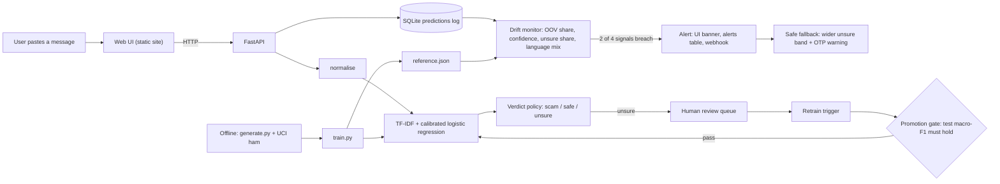

# Vortex OTP Classifier

> First-time mobile-banking users and pensioners in Sri Lanka are tricked by SMS and WhatsApp messages
> in Sinhala, Tamil and Singlish that impersonate their bank to steal one-time passwords (OTPs)
> ("your account is blocked, share the code to reactivate"). We build a scam checker that flags these
> messages and detects when scammers switch to a new impersonated bank, new wording or a new language
> mix, before it silently fails.

## Who it protects and why now
First-time mobile-banking users and pensioners are the people most likely to read a message that says
"your account is blocked" and share a code under pressure. A user pastes a suspicious message and gets a
verdict (scam, safe or unsure), a confidence score and the reasons. When scammers change tactics, the
system notices and falls back to "unsure: never share your OTP, call your bank". Details and sources are
in [IMPACT.md](IMPACT.md).

## Quick start
```bash
git clone https://github.com/DeepCover-spec/Vortex-OTP-classifier.git
cd Vortex-OTP-classifier
cp .env.example .env        # Windows cmd: copy .env.example .env
docker compose up --build
# Web UI:  http://localhost:8080     API docs:  http://localhost:8000/docs
```
Without Docker (Python 3.11 or 3.12 only, not 3.13+):
```bash
pip install -r requirements.txt
python data/generate.py
python src/train.py
uvicorn api.main:app --port 8000
# in a second terminal:
cd ui
python -m http.server 8080      # open http://localhost:8080
```
On Windows without `make`, `run.cmd` (cmd) or `.\run.ps1` (PowerShell) wraps the data, train, eval, demo and
retrain steps.

## Architecture

A message goes through the shared normaliser and the calibrated model, and a threshold policy turns the
probability into scam, safe or unsure. Every prediction is logged, the monitor compares recent traffic
with training statistics, and drift triggers a safe fallback, human review and a gated retrain.
Shared interfaces are described in [docs/INTERFACES.md](docs/INTERFACES.md).

## Data
All training and evaluation data is **synthetic**, generated by our own script during the build window.
No third-party dataset is used, so there is no licence risk and no real personal data.

| Source | Used for | Licence / method |
|---|---|---|
| `data/generate.py` (team-written, AI-assisted, declared below) | Every row: scams, genuine bank messages, everyday messages, shifted set | Synthetic, template-based, seed 42; released under this repo's licence |
| UCI SMS Spam Collection (CC BY 4.0) | Not used | Reviewed; contains no Sri Lankan bank-impersonation OTP scams |
| Mendeley SMS phishing dataset | Not used | No licence stated; 78% overlap with UCI |

**How it is generated.** Scams are assembled from parts (pretext + request + urgency + closing) in English,
Singlish, Sinhala, Tamil and Tanglish, with light noise (casing, typos, emoji). About a third of all rows are
*hard negatives*: genuine bank OTPs, debit alerts, pension credits, KYC reminders and "we never ask for your OTP"
notices. Codes, links, masked phone numbers, urgency words and "do not share" wording appear in **both** classes,
so no single surface cue gives the label away (checked by `data/check_dataset.py`).

**Privacy.** Fictional banks only (Hela Bank, LankaSave, Ceylon Trust Bank, Ruhunu Union Bank; shifted senders
Serendib Pay and SL-UDI Helpdesk), phone numbers masked (`07X-XXX-XXXX`), links on the reserved `.example`
domain, random codes. Synthetic scams are used for training and testing only and are never sent or posted.

| File | Rows | Purpose |
|---|---|---|
| `train.csv` | 4,000 (1,800 scam / 2,200 safe) | Training and grouped cross-validation |
| `test.csv` | 999 (450 scam / 549 safe) | **Held-out test set.** Every 4th template phrasing is reserved for test, so test wording is never seen in training (0 shared templates, 0 duplicates) |
| `shifted.csv` | 800 (400 / 400) | **Shifted set for the drift demo.** New senders, new pretexts (SL-UDI digital ID, "it is only a reference number, not an OTP", pension top-up) and Tanglish rising from 11% to 26%. Split by phrasing into `shifted_review` (what reviewers label) and `shifted_eval` (never trained on) |

Every language is about 45% scam, so the script a message is written in never predicts the label.
Language mix in train: English 32%, Singlish 25%, Sinhala 17%, Tamil 15%, Tanglish 11%.

```bash
python data/generate.py          # writes data/processed/{train,test,shifted}.csv (seed 42, identical every run)
python data/check_dataset.py     # balance, leakage, shortcut and drift checks -> reports/dataset_report.md
```
Full design reasoning: [data/DATA_CARD.md](data/DATA_CARD.md).

## Results
**Model:** TF-IDF word 1–2 grams + character 2–5 grams (`char_wb`, handles Sinhala/Tamil script, romanised
spellings and typos) → binary logistic regression (L2, `C=4`, `class_weight="balanced"`) wrapped in
`CalibratedClassifierCV` (sigmoid / Platt scaling, 5 folds) so the scam probability is trustworthy for the
monitor. Text is normalised first: codes, phone numbers and amounts are masked; links are kept because
look-alike domains are real evidence.

```bash
python src/train.py --cv    # trains, prints grouped CV, saves models/model.joblib
python src/evaluate.py      # writes reports/metrics.json, reports/confusion_*.png, models/reference.json
```

| Set | Accuracy | Macro-F1 | Scam recall | False alarms on genuine bank msgs | Mean confidence | Unsure share |
|---|---|---|---|---|---|---|
| GroupKFold(5) CV on train, grouped by template | 0.967 | 0.967 | | | | |
| **Held-out test** (unseen phrasings) | **0.874** | **0.873** | **0.887** | 0.235 | 0.868 | 0.225 |
| Shifted set (drift) | 0.740 | 0.721 | 0.480 | 0.000 | 0.831 | 0.352 |

When the model gives a confident verdict (scam or safe, not unsure) it is wrong **6.7%** of the time on the test
set, versus 17% on the shifted set: that gap is what the unsure fallback and the drift monitor are for.

**Baselines on the held-out test set:** always "safe" 0.549 accuracy; keyword rule ("OTP/code/PIN" near
"reply/send/share/tell") 0.800 accuracy, 0.782 macro-F1. Our model beats both.

| Test accuracy by language | en | singlish | si | ta | tanglish |
|---|---|---|---|---|---|
| | 0.87 | 0.75 | 1.00 | 0.86 | 1.00 |

| Test accuracy by subtype | otp_scam | bank_genuine | everyday |
|---|---|---|---|
| | 0.89 | 0.76 | 1.00 |

**Experiments that shaped the model:** masking links to a single token dropped test accuracy from 0.874 to
0.785 (look-alike domains such as `-verify` and `secure-login` are evidence), so links are kept. Calibration
costs about 2 points of accuracy but makes confidence values meaningful for the drift signals, so we kept it.

## Monitoring and drift response
**Logging.** Every prediction is written to SQLite (`data/monitor.db`): masked text and a hash (codes, phone
numbers and other numbers removed), language, unseen-word share, scam probability, confidence, verdict, model
version, drift flag and review status.

**Reference.** `models/reference.json` holds the model's behaviour on the held-out test set (training-set
confidence is inflated): mean confidence 0.868, unseen-word share 0.181, unsure share 0.225, and the language mix.

**Drift signals** (computed over the last 100 predictions):

| Signal | Alert when | Normal windows (test) | Shifted windows |
|---|---|---|---|
| Unseen-word (OOV) share | above 0.255 | 0.16–0.21 | 0.30–0.32 |
| Mean confidence | below 0.846 | 0.85–0.89 | 0.82–0.85 |
| Unsure share | above 0.30 | 0.18–0.30 | 0.30–0.40 |
| Language-mix shift (total-variation distance from reference) | above 0.128 | 0.04–0.10 | 0.16–0.21 |

**How thresholds were chosen.** `python src/monitor.py --calibrate` replays the test and shifted sets in windows
of 100 and places each threshold midway between the worst normal window and the mildest shifted window.
Drift is active when **2 of the 4 signals** breach together, and only on a full window. Result: drift flagged in
**0 of 9** normal windows (no false alarms) and **8 of 8** shifted windows.

**Drift response.**
1. **Alert:** one alert per drift episode in the `alerts` table, a console line, and the UI banner.
2. **Safe fallback:** the unsure band widens from 0.30–0.70 to 0.20–0.85; unsure users see "We are not sure.
   Never share your OTP or PIN with anyone, including bank staff. Call your bank on the number on the back of
   your card."
3. **Human review:** every unsure prediction, and every message seen while drift is active, is queued for a
   reviewer to label scam or safe.
4. **Retraining trigger with a promotion gate:** with at least 50 reviewed labels, `src/retrain.py` retrains on
   train + reviewed messages. The new model is promoted only if held-out test macro-F1 drops by no more than
   0.01; the old model is kept in `models/versions/`, and `reference.json` is recomputed. Held-out test messages
   are never labelled or trained on.

**Demo** (`python scripts/run_shift_demo.py`, about 10 seconds, no server needed):

| Stage | OOV share | Unsure share | Drift |
|---|---|---|---|
| 200 normal messages (test set) | 0.16–0.18 | 0.15–0.19 | no |
| 400 new-style messages (`shifted_review`) | rises to 0.36 | rises to 0.60 | **alert** |
| After retraining, unseen new-style messages (`shifted_eval`) | 0.06 | 0.19 | clears |

| Retrained on 373 reviewed messages | Before | After |
|---|---|---|
| `shifted_eval` accuracy (never trained on) | 0.718 | **0.953** |
| `shifted_eval` scam recall | 0.435 | **0.905** |
| Held-out test macro-F1 (promotion gate) | 0.873 | 0.922 → **promoted** |

## Model card and limits
- **Intended use:** a second opinion for individuals (first-time mobile-banking users, pensioners) on whether an
  SMS or WhatsApp message is a bank-impersonation OTP scam. Output: scam / safe / unsure, confidence and reasons.
- **Not intended for:** replacing the bank's own verification, blocking messages automatically, or judging
  message types it was not trained on (investment scams, lottery scams, romance scams).
- **Model:** calibrated logistic regression on word + character TF-IDF; version string in `models/meta.json`.
- **Data:** fully synthetic (see Data); fictional banks; no real personal data.
- **Metrics:** held-out test accuracy 0.874, scam recall 0.887; confident-verdict error 6.7%.
- **Known limits:**
  - Synthetic, template-based text is cleaner and less varied than real messages; real-world accuracy will be lower.
  - 23.5% of genuine bank messages with unseen wording (KYC reminders, verification codes) are flagged as scam.
    The unsure band and "call your bank" advice limit the harm, but this is the first thing to improve.
  - Dialect and spelling coverage of Singlish and Tanglish is limited; Sinhala and Tamil lines need native-speaker review.
  - The language detector is a simple script/keyword heuristic, good enough for monitoring the mix, not for linguistics.
  - Next step: consented, anonymised messages from a bank partner or CERT reports, and native-speaker review.

## Impact
First-time mobile-banking users, pensioners and their families get a check before they share a code. Sources,
reach estimates and the pilot path are in [IMPACT.md](IMPACT.md).

## AI tools used
- **Claude (Anthropic):** project planning, the repo skeleton and shared-interface stubs, run scripts,
  and the README and architecture diagram drafts.
- **Cursor Agent:** used by Hisshan (P4) for code drafting.
- **Claude (Anthropic), P2 and P3 (Adhni, Anuja):** drafting the synthetic data generator and dataset checks,
  the text normaliser, training and evaluation scripts, and the drift monitor, review queue, retraining gate
  and demo script. Design choices (masking, calibration, thresholds) were tested and measured by the team.

Every AI-written part was reviewed and run by a team member before commit.

## Team
| Role | Name |
|------|------|
| P1 Lead, repo, integration | Raihan |
| P2 Data, model, evaluation | Adhni |
| P3 Monitoring, drift response | Anuja |
| P4 Backend, DevOps | Hisshan |
| P5 Front end, impact, pitch | Esandi |